# AI-Agent Web Optimization Skill

A battle-tested, non-breaking protocol for auditing, engineering, and certifying any web application or e-commerce storefront for autonomous AI agents, LLM search engines (Perplexity, ChatGPT Search, Google SGE), web crawlers, and in-browser assistants.

Modern AI agents navigate websites differently than human users or legacy SEO bots. While traditional search crawlers prioritize backlink graphs and keyword density, AI agents require:
1. **Low-Token Density & Direct Semantics**: Eliminating DOM noise, SVG clutter, and heavy script bundles.
2. **Explicit Knowledge Graph Triples**: Structured entity definitions (`Organization`, `Product`, `Offer`, `sameAs`).
3. **Machine-Actionable Protocol Endpoints**: `llms.txt`, RFC 8288 `Link` discovery headers, and Model Context Protocol (MCP) tool endpoints.
4. **Zero-JavaScript SSR Resilience**: Pricing, offers, and business policies accessible without client-side hydration or authentication.

---

## The 16 Core Agent-Readiness Benchmarks

Every project audited or built with this skill is evaluated against these 16 benchmarks:

| # | Benchmark Goal | Agent Failure Mode if Missing | Solution Standard |
|---|---|---|---|
| **1** | **Content Signals in `robots.txt`** | Agents assume unauthorized scraping risk or block training | Declare `Content-Signal: search=yes, ai-train=no` |
| **2** | **Real HTTP 404/410 for Missing Pages** | Agents treat `200 OK` as page existence, polluting context | Return genuine 404 status before streaming flushes |
| **3** | **Clear Heading Hierarchy** | LLMs cannot determine the page's primary entity or topic | Exactly ONE `<h1>` on homepage and all core pages |
| **4** | **JSON-LD Structured Data** | Agent relies on fragile DOM text heuristics | Multi-entity `<script type="application/ld+json">` graph |
| **5** | **Organization/LocalBusiness Node** | Entity authentication fails; site flagged as unverified | Complete `Organization` or `LocalBusiness` schema |
| **6** | **External Disambiguation (`sameAs`)** | LLMs hallucinate brand identity; cannot link external authority | Link Facebook, Instagram, LinkedIn, Crunchbase |
| **7** | **Multi-Schema Coverage** | Shallow metadata misses products, categories, or search | Declare `WebSite`, `Product`, `Offer`, `ItemList` |
| **8** | **Linked About, Contact & Legal Pages** | Commercial trust score drops; flagged as potential scam | Direct anchor links to `/about`, `/contact`, `/terms`, `/privacy` |
| **9** | **Machine-Readable Contact Details** | Vision/OCR required to read contact details | Native `mailto:` and `tel:` links + schema `ContactPoint` |
| **10** | **Plain-Text `llms.txt` Served** | Agent parser fails on HTML catch-all redirects | Serve `/llms.txt` with `Content-Type: text/plain` |
| **11** | **Well-Formed `llms.txt`** | Unstructured text confuses context parsers | Top `# ` heading, `> ` summary, `- [Name](URL):` items |
| **12** | **Markdown Content Negotiation** | 70–90% token waste from HTML markup, CSS, and JS | Intercept `Accept: text/markdown` and return pure MD |
| **13** | **RFC 8288 `Link` Discovery Headers** | Crawler must scrape DOM to discover agent resources | Emit `Link: </llms.txt>; rel="describedby"` |
| **14** | **In-Browser WebMCP Tool Registration** | In-browser agents cannot take reliable UI actions | Expose `registerTool()` or `toolname` form attributes |
| **15** | **SEP-1649 MCP Server Card** | External agents cannot discover remote tools | Publish `/.well-known/mcp/server-card.json` + `/api/mcp` |
| **16** | **Zero-JS & Zero-Login Pricing** | Headless crawlers without JS see empty cart or missing price | SSR `/pricing` page + schema `Offer` with currency |

---

## The 5-Stage Optimization Protocol

```mermaid
flowchart TD
    subgraph S1["Stage 1: Discovery & Agent Directives"]
        D1["Add Content-Signal & AI bots to robots.txt"]
        D2["Generate structured /llms.txt and /llms-full.txt"]
        D3["Emit RFC 8288 Link headers on all responses"]
    end

    subgraph S2["Stage 2: Knowledge Graph & Structured Data"]
        K1["Consolidate JSON-LD into unified @graph"]
        K2["Add Organization/LocalBusiness with sameAs links"]
        K3["Markup Products with Offer, price, and currency"]
        K4["Add ItemList for catalogues and collections"]
    end

    subgraph S3["Stage 3: Document Semantics & Trust Graph"]
        H1["Audit headings: Ensure exactly one <h1> per page"]
        H2["Convert contact info to mailto: and tel: links"]
        H3["Place crawlable links to /about, /contact, /terms, /privacy in footer"]
    end

    subgraph S4["Stage 4: Content Negotiation & Zero-JS Fallback"]
        C1["Middleware: Handle Accept: text/markdown"]
        C2["Verify real HTTP 404 for missing routes (no soft 404s)"]
        C3["Eliminate SSR client hydration gates (if (!mounted) return null)"]
        C4["Deploy static /pricing table with Offer microdata"]
    end

    subgraph S5["Stage 5: WebMCP & Agent Tooling Protocols"]
        M1["Register navigator.modelContext.registerTool() in provider"]
        M2["Annotate HTML search and lookup forms with toolname"]
        M3["Publish SEP-1649 /.well-known/mcp/server-card.json"]
        M4["Deploy JSON-RPC 2.0 endpoint at /api/mcp"]
    end

    S1 --> S2 --> S3 --> S4 --> S5
```



---

## Stage 1: Protocol Discovery & Directives

### 1. Configure `robots.txt` with Content Signals
Modern crawlers (such as `GPTBot`, `ClaudeBot`, `PerplexityBot`, and `Google-Extended`) respect content signals. Add the `Content-Signal` directive specifying usage policies:

```text
# public/robots.txt
User-agent: *
Allow: /
Disallow: /admin
Disallow: /api/admin
Disallow: /checkout
Disallow: /order-success

User-agent: GPTBot
Allow: /

User-agent: ClaudeBot
Allow: /

User-agent: PerplexityBot
Allow: /

User-agent: Google-Extended
Allow: /

User-agent: Applebot-Extended
Allow: /

# Agent Content Usage Directive (W3C / IETF AI Standard)
Content-Signal: search=yes, ai-train=no

Sitemap: https://<domain>/sitemap.xml
```

### 2. Generate and Serve Well-Formed `/llms.txt`
Place a well-structured index at `public/llms.txt` and ensure your server serves it as `text/plain; charset=utf-8`:

```markdown
# <Brand Name>

> <Brand Name> is a <core mission or service description in 1-2 factual sentences>.

## Core Discovery & Services
- [Product Catalogue](https://<domain>/shop): Complete product index with live inventory.
- [Pricing & Offer Catalogue](https://<domain>/pricing): Itemized prices in local and major currencies.

## Customer Operations & Policies
- [About](https://<domain>/about): Studio heritage and craftsmanship ethics.
- [Contact Support](https://<domain>/contact): Direct customer care channels.
- [Terms & Conditions](https://<domain>/terms): Official purchasing agreement and policies.
- [Privacy Policy](https://<domain>/privacy): Data handling and customer privacy safeguards.

## Machine-Readable Resources
- [MCP Server Card](https://<domain>/.well-known/mcp/server-card.json): SEP-1649 MCP Server Card.
- [Sitemap](https://<domain>/sitemap.xml): Canonical list of all URLs.
```

See [references/llms-txt-spec.md](./references/llms-txt-spec.md) for full specification guidelines.

### 3. Emit RFC 8288 `Link` Headers
Inform crawlers before they begin parsing HTML by sending an RFC 8288 `Link` response header:
```http
Link: </llms.txt>; rel="describedby"; type="text/plain", </>; rel="alternate"; type="text/markdown"
```

---

## Stage 2: Knowledge Graph & Structured Data

Consolidate all structured nodes into a unified JSON-LD `@graph`. This eliminates fragmented blocks and allows agents to follow foreign keys (e.g. `seller: { "@id": "https://<domain>/#organization" }`).

### Key Schema Requirements:
1. **`Organization`**: Name, legal name, URL, logo, description, telephone, email, physical address, and `sameAs` array linking to official social profiles and directory pages.
2. **`WebSite`**: Canonical URL, publisher ID, and `SearchAction` (`potentialAction`) declaring search endpoints.
3. **`Product` & `Offer`**: Name, description, image, SKU, brand, and nested `Offer` declaring:
   - `price`: Numeric price (e.g. `249`).
   - `priceCurrency`: 3-letter ISO 4217 code (e.g. `USD`, `BDT`, `EUR`).
   - `availability`: `https://schema.org/InStock` or `https://schema.org/OutOfStock`.
   - `itemCondition`: `https://schema.org/NewCondition`.
   - `priceValidUntil`: Future ISO date string (e.g. `2027-12-31`).
4. **`ItemList`**: Ordered list of curated products, collections, or bestseller sequences with nested offers.

See [references/json-ld-templates.md](./references/json-ld-templates.md) for copy-pasteable production schemas.

---

## Stage 3: Document Semantics & Trust Graph

### 1. Heading Hierarchy (Strict Single `<h1>`)
- Exactly **one** `<h1>` per page.
- The `<h1>` must describe the main entity or topic of the page (e.g., `Brand Name — Luxury Boutique Studio`).
- If visual design demands no large title text, retain the `<h1>` with an accessible `.sr-only` class rather than deleting it.
- Never place `<h1>` tags inside repeated components (e.g. header logos, navigation drawers, or footer banners).

### 2. Machine-Readable Contact Links
Avoid placing phone numbers or email addresses exclusively inside images, SVG text, or JavaScript alerts:
- Email: `<a href="mailto:support@domain.com">support@domain.com</a>`
- Phone: `<a href="tel:+1234567890">+1 (234) 567-890</a>`

### 3. Permanent Global Footer Links
AI search engines (Perplexity, ChatGPT Search, Google SGE) assess merchant legitimacy via the presence of direct crawlable links to:
- `/about`
- `/contact`
- `/terms`
- `/privacy`
- `/returns-exchange` (or `/refund-policy`)

Ensure these links are rendered in server-side HTML in the footer and main navigation.

---

## Stage 4: Content Negotiation & Zero-JS Fallback

### 1. Markdown Content Negotiation (`Accept: text/markdown`)
When an AI agent requests markdown via HTTP headers, intercept the request and return clean, semantic Markdown:

```typescript
// Next.js Middleware or Edge Proxy
const acceptHeader = req.headers.get('accept') || '';
if (acceptHeader.includes('text/markdown') && req.nextUrl.pathname === '/') {
  return new NextResponse(HOMEPAGE_MARKDOWN, {
    status: 200,
    headers: {
      'Content-Type': 'text/markdown; charset=utf-8',
      'Vary': 'Accept',
      'Link': '</llms.txt>; rel="describedby"; type="text/plain", </>; rel="alternate"; type="text/markdown"',
    },
  });
}
```

### 2. Guarantee Genuine HTTP 404 Status (No Soft 404s)
In SSR frameworks (like Next.js App Router), wrapping routes in `<Suspense>` streams HTTP 200 headers before child route components can throw `notFound()`.
- **Fix**: Validate route slugs early in proxy/middleware or synchronous root page loader before streaming begins.
- Return explicit `status: 404` with `X-Robots-Tag: noindex, nofollow`.

### 3. Eliminate Client Hydration Suppression
Check your global providers (e.g. ThemeProvider, CartProvider, OfferContext).
```typescript
// ❌ CRITICAL BUG: Wipes out SSR HTML for crawlers and headless agents
if (!isHydrated) return null;

// ✅ CORRECT: Always render children with unhydrated defaults during SSR
return <OfferContext.Provider value={defaultState}>{children}</OfferContext.Provider>;
```

### 4. Zero-JS `/pricing` Page
Create a dedicated `/pricing` route returning a pure HTML table or list with:
- Product names, descriptions, categories, exact prices, currency codes, and stock status.
- Microdata attributes: `itemScope itemType="https://schema.org/Product"` and `itemProp="offers" itemScope itemType="https://schema.org/Offer"`.
- Direct links to product pages.

See [references/framework-recipes.md](./references/framework-recipes.md) for full framework-specific setups.

---

## Stage 5: WebMCP & Agent Tooling Protocols

### 1. In-Browser WebMCP Tool Registration
Enable in-browser AI assistants (e.g. Chrome Gemini Nano, browser extensions) to invoke site capabilities:
- **Imperative**: `navigator.modelContext.registerTool({ name, description, inputSchema, execute })`.
- **Declarative**: Add `toolname="search_catalogue"` and `tooldescription="Search products..."` to standard `<form>` elements.

### 2. Publish SEP-1649 MCP Server Card
Publish your server manifest at:
`https://<domain>/.well-known/mcp/server-card.json`

```json
{
  "schema_version": "1.0.0",
  "name": "brand-mcp-server",
  "version": "1.0.0",
  "description": "Official MCP server exposing product lookup and order status tools to AI agents.",
  "endpoint": "https://<domain>/api/mcp",
  "transport": "http",
  "capabilities": { "tools": { "listChanged": false } },
  "tools": [
    {
      "name": "search_products",
      "description": "Search catalogue by keyword or category",
      "inputSchema": {
        "type": "object",
        "properties": { "query": { "type": "string" } },
        "required": ["query"]
      }
    }
  ]
}
```

Deploy the matching JSON-RPC 2.0 endpoint at `/api/mcp`. See [references/mcp-server-card-spec.md](./references/mcp-server-card-spec.md).

---

## Automated Audit & Verification

### Running the Included Audit Script
An automated, self-contained audit script is provided at [`./scripts/audit-agent-readiness.sh`](./scripts/audit-agent-readiness.sh).

```bash
# Audit a local development server
./scripts/audit-agent-readiness.sh http://localhost:3000

# Audit a live production domain
./scripts/audit-agent-readiness.sh https://example.com
```

### Manual Quick-Check Commands

```bash
# 1. Verify robots.txt Content-Signal
curl -sL "https://<domain>/robots.txt" | grep -Ei "Content-Signal"

# 2. Verify Real HTTP 404 Status
curl -s -o /dev/null -w "%{http_code}\n" "https://<domain>/non-existent-probe-12345"

# 3. Verify Single <h1> on Homepage
curl -sL "https://<domain>/" | grep -Eio "<h1[^>]*>" | wc -l

# 4. Verify llms.txt Plain-Text MIME Type
curl -sI "https://<domain>/llms.txt" | grep -Ei "content-type"

# 5. Verify Markdown Content Negotiation
curl -sI -H "Accept: text/markdown" "https://<domain>/" | grep -Ei "content-type"

# 6. Verify RFC 8288 Link Header
curl -sI "https://<domain>/" | grep -Ei "^link:"

# 7. Verify MCP Server Card
curl -s "https://<domain>/.well-known/mcp/server-card.json" | grep -Ei "schema_version"
```

---

## Reference Guides
- [JSON-LD Structured Data Templates](./references/json-ld-templates.md)
- [llms.txt and llms-full.txt Standard Specification](./references/llms-txt-spec.md)
- [SEP-1649 MCP Server Card & WebMCP Specification](./references/mcp-server-card-spec.md)
- [Framework-Specific Implementation Recipes (Next.js, Astro, Nuxt, Vite)](./references/framework-recipes.md)
- [Automated Audit Script](./scripts/audit-agent-readiness.sh)
