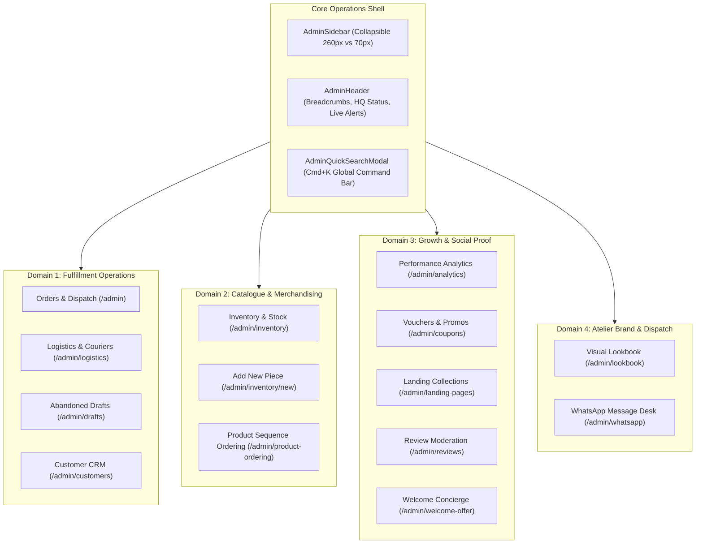
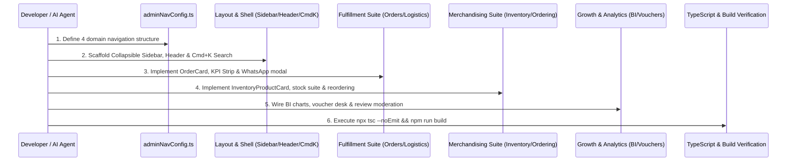

# E-Commerce Admin Operations Suite Skill

A production-grade, architectural standard and implementation guide for building, modernizing, and organizing an executive-grade **E-Commerce Admin Operations Suite** in Next.js App Router applications.

---

## 1. Architectural Philosophy & Invariants

Generic admin templates fail e-commerce and retail operators because they are organized as **isolated database tables** rather than **streamlined operational workflows**:
1. **Monolithic Page Bloat:** Putting 2,000+ lines of table views, modals, inline editors, and API callers in a single `page.tsx` creates severe performance lag, re-render cascading, and brittle code.
2. **Slow Dispatch Velocity:** Dispatchers are forced to open multiple tabs to verify orders, look up customer history, calculate COD amounts, check courier status, and send WhatsApp confirmation messages.
3. **Disconnected Merchandising & Stock:** Inventory editing that requires navigating to full-page forms for simple price tweaks, stock increments, or badge toggles slows down catalog maintenance.
4. **Lack of Fast Navigation:** Hunting through nested links without an instant command bar (<kbd>Cmd</kbd> + <kbd>K</kbd>) or persistent collapsible navigation hinders day-to-day productivity.

### The 4 Operational Domains



---

## 2. Global Shell & Navigation Architecture

### A. Navigation Configuration (`adminNavConfig.ts`)
Group all admin pages by domain rather than flat links. Each item defines an `id`, `label`, `href`, `icon`, `domain`, and optional dynamic `badgeKey`:

```typescript
export type AdminDomain = 'fulfillment' | 'catalogue' | 'growth' | 'atelier';

export interface AdminNavItem {
  id: string;
  label: string;
  href: string;
  iconName: string;
  domain: AdminDomain;
  badgeKey?: 'pendingOrders' | 'pendingReviews';
}
```

### B. Dual-State Collapsible Sidebar (`AdminSidebar.tsx`)
- **Expanded State (260px):** Full domain headings, item labels, and numeric alert badges.
- **Collapsed State (70px):** Icon-only rail with tooltips, preserving maximum horizontal canvas for tables and cards.
- **Persistence:** Save state in `localStorage.getItem('admin_sidebar_collapsed')` on toggle.
- **Mobile Off-Canvas:** Slide-out drawer with backdrop overlay, automatically closing on Next.js `pathname` changes.

### C. Executive Operations Header (`AdminHeader.tsx`)
- Dynamic breadcrumb resolution mapping routes (e.g., `Admin / Merchandising / Inventory`).
- Real-time headquarters heartbeat indicator (`HQ Online` with green pulse dot).
- Quick alert pills (e.g., `3 Pending Orders` deep-linking to filtered `/admin?status=pending`).
- Storefront deep-link button (`Preview Store` in new tab).
- Search modal trigger button showing <kbd>Cmd</kbd> + <kbd>K</kbd>.

### D. Global Command & Quick Search Bar (`AdminQuickSearchModal.tsx`)
Listens globally for <kbd>Cmd</kbd> + <kbd>K</kbd> / <kbd>Ctrl</kbd> + <kbd>K</kbd>. Provides instant regex routing:
1. **Order Search:** Inputs matching `AF-` or order prefixes immediately filter and open orders.
2. **Customer Search:** Inputs starting with `01` or digit patterns jump straight to filtered customer CRM.
3. **Route Navigation:** Instant fuzzy search across all 14 admin surfaces with keyboard arrow selection.

---

## 3. High-Velocity Fulfillment Operations Suite

### A. Financial Pipeline Strip (`OrderStatsHeader.tsx`)
Place 4 or 6 critical financial metrics at the top of the orders page:
- **Gross Pipeline Revenue:** Total value of all uncancelled orders.
- **Collected Cash on Delivery:** Total BDT deposited by couriers for completed parcels.
- **COD in Transit:** Capital currently held by delivery partners (Steadfast, Pathao, RedX).
- **Pending Orders Count:** Direct filter button showing orders awaiting verification.

### B. The 3-Column Unified Order Card (`OrderCard.tsx`)
Eliminate modal click-throughs by condensing each order into a responsive 3-column operational card:

```
+---------------------------+---------------------------+---------------------------+
| 1. Customer & Address     | 2. Items & Variations     | 3. Settlement & Dispatch  |
| - Patron Name & Phone     | - Thumbnail & Title       | - Subtotal & Discounts    |
| - Delivery Zone Badge     | - Inline Quantity Stepper | - Delivery Charge Presets |
| - Full Street Address     | - Selected Color/Size     | - Calculated COD Override |
| - Courier Tracking ID     | - Swap Product Modal Btn  | - WhatsApp Dispatch Strip |
| - Notes & Verification    | - Line Total (৳)          | - Status Progress Buttons |
+---------------------------+---------------------------+---------------------------+
```

#### Key Implementation Details:
1. **Inline Quantity Editing:** Allow dispatchers to increment/decrement item counts directly on the card. Recalculate subtotal, delivery, and grand total in real time.
2. **Delivery Charge Presets:** One-click buttons for standard delivery rates (e.g., `৳0 Free`, `৳70 Inside`, `৳130 Outside`, or Custom).
3. **COD Calculation & Override:** Automatically update COD when quantities or charges change, while allowing a manual override lock for partial advance payments (e.g., bKash partial).
4. **WhatsApp Verification Dispatch:**
   - One-click copy formatted WhatsApp verification text with polite phrasing and itemized breakdown.
   - Direct `wa.me/880...` deep-link button opening WhatsApp Web/Desktop.
   - Meta Cloud API direct send action if integrated.
   - In-place per-order message editor modal (`CustomizeWhatsAppModal.tsx`).
5. **Courier Portal Deep-Links:** Clicking the courier tracking waybill opens the parcel directly on Steadfast (`steadfast.com.bd/tracking/...`) or Pathao.

---

## 4. Merchandising & Catalogue Studio

### A. Live Stock & Inventory Valuation Strip (`InventoryMetricsHeader.tsx`)
- **Total Catalogue SKUs:** Total active piece designs.
- **In-Stock Readiness:** Count of items available for immediate dispatch.
- **Low Stock Threshold Alert:** Items with 1 or 2 units left, styled with an amber pulse badge.
- **Catalogue Valuation:** Total monetary value of stock on hand in BDT.

### B. High-Aesthetic Product Card (`InventoryProductCard.tsx`)
- **Validated Still-Life Thumbnail:** Preview still-life imagery with fallback icons.
- **Inline Price & Discount Calculator:**
  - Base price input with instant selling price preview based on `percent` or `flat` discount.
  - Compares original price with selling price.
- **Dual Stock Mode Suite:**
  - *Unlimited Stock Mode:* (`stockQty: null`) for made-to-order or high-capacity items.
  - *Tracked Units Mode:* (`stockQty: number`) with direct integer stepper.
  - Instant server action sync (`updateStockAction`) without reloading the page.
- **Badge Matrix Toggles:** Quick toggle pills for `New Drop`, `Bestseller`, and `Gift Pick`.
- **Visibility Guard:** One-click switch between `Live on Storefront` and `Hidden Internal Draft`.
- **Category Hero Cover Deep-Link:** Sets the product image as the hero banner for its category page.

### C. Product Display Ordering (`/admin/product-ordering`)
Give store owners complete control over how products appear under the default "Featured" sort:
- **Shopify-Style Drag & Drop:** Grab handle (`⠿`) with visual drop indicator to resequence products manually.
- **Automated Sort Presets:**
  - *Most Purchased First:* Calculated live from order line items.
  - *Best Rating:* Calculated from approved 5-star customer reviews.
  - *New Drops First:* Prioritizes active campaign drops.
  - *Oldest to New:* Heritage released pieces.
- **Category & Landing Page Tabs:** Switch between category catalogs (`/shop`, `/jewelry`, `/bags`, `/churi`) and campaign landing collections (`/collections/...`).
- **Database Persistence:** Save the exact array of product IDs via server action (`setOrdering`).

---

## 5. Growth, Marketing & Social Proof Suite

### A. Cash Flow & BI Analytics (`/admin/analytics`)
- **Revenue Trend:** Recharts curved line graph of gross revenue over rolling 7-day or 30-day windows.
- **Regional Delivery Demand:** Donut / Pie chart distinguishing Metropolitan (Inside Dhaka) vs. Outer Districts (63 districts), highlighting free shipping threshold adoption.
- **Category Demand Velocity:** Horizontal bar chart ranking units sold per category.
- **Luxury Dark Glass Tooltip:** Recharts custom tooltip using `bg-[#121212]/95 backdrop-blur-md border border-gold/40 shadow-2xl font-mono`.

### B. Vouchers & Promotions Desk (`/admin/coupons`)
- Support 3 distinct voucher mechanisms:
  1. `percentage`: Percentage off with optional maximum BDT cap (`maxDiscountAmount`).
  2. `fixed`: Flat BDT discount.
  3. `free_shipping`: Eliminates courier delivery charge nationwide.
- Safeguards: Minimum order spend threshold (`minOrderAmount`), global usage limit (`usageLimit`), and expiration timestamps (`expiresAt`).
- Patron Value Granted KPI: Total monetary discount absorbed by the store across all orders.

### C. Review Moderation Desk (`/admin/reviews`)
- 3-Stage Moderation Queue: `Pending (Action Required)`, `Approved (Live on Store)`, and `Rejected`.
- **Product Context Card:** Automatically resolve `review.productId` to display the actual product thumbnail, title, category, and direct catalogue link—eliminating ambiguity about which item the patron reviewed.
- Customer Still-Life Photo preview modal.

### D. Dynamic WhatsApp Template Desk (`/admin/whatsapp`)
- Variable Tag System: Clickable tags (`{customer_name}`, `{order_id}`, `{grand_total}`, `{items_list}`, `{delivery_address}`) that insert into the template at current cursor position.
- Live Smartphone Mockup: Shows the exact rendered bubble with WhatsApp green accents, patron avatar, and double checkmarks (`✓✓`).
- Test Dispatcher: Send a test message directly to an admin phone number before saving.

---

## 6. Luxury Atelier Design System & Tokens

To convey high craftsmanship and luxury, apply the **Luxury Atelier Dark** aesthetic:

| Token | Value | Purpose |
| :--- | :--- | :--- |
| **Canvas Background** | `#0E0E0E` | Main page canvas background |
| **Card Surface** | `#141414` / `#171717` | Card and modal surfaces |
| **Surface Elevate** | `#1C1C1C` / `#222222` | Hover states, inputs, and wells |
| **Border Subtle** | `border-white/10` | Standard divider and container borders |
| **Border Accent** | `border-gold/40` (`#C6A96E`) | Active selection, primary highlights |
| **Gold Primary** | `#C6A96E` / `#D4AF37` | Primary buttons, active tabs, brand accents |
| **Emerald Status** | `#10B981` / `#059669` | Delivered orders, live status, revenue |
| **Amber Warning** | `#F59E0B` / `#D97706` | In-transit COD, pending alerts, low stock |
| **Rose Danger** | `#F43F5E` / `#E11D48` | Cancelled orders, rejected reviews, deletes |
| **Typography Numbers**| `font-mono tabular-nums` | All monetary sums, order IDs, quantities |
| **Corner Radius** | `rounded-xs` (`2px` - `4px`) | Crisp, architectural, tailored corners |

### Strict Still-Life Imagery Policy
> [!IMPORTANT]
> For luxury jewelry and atelier goods, maintain an uncompromising visual identity: **100% still-life product photography** on limestone/warm stone plinths (`#DDD6CB`), velvet jewelry busts, or keepsake trays. Strictly **NO women models, faces, or human silhouettes** anywhere in admin previews or storefront renders.

---

## 7. Universal Data Contract

Implement the admin suite against these TypeScript interfaces:

```typescript
export type OrderStatus = 'pending' | 'packaging' | 'handed_to_courier' | 'delivered' | 'cancelled';

export interface AdminOrderItem {
  id: string;
  productId: string;
  quantity: number;
  selectedColor?: string | null;
  selectedSize?: string | null;
  unitPrice: number;
  totalPrice: number;
  product: {
    id: string;
    slug: string;
    name: string;
    category: string;
    price: number;
    featuredImage: string;
  };
}

export interface AdminOrder {
  id: string;
  orderNumber?: string;
  createdAt: string;
  status: OrderStatus;
  customer: {
    name: string;
    phone: string;
    email?: string | null;
    address: string;
    city: string;
    district: string;
  };
  items: AdminOrderItem[];
  subtotal: number;
  discount: number;
  deliveryCharge: number;
  grandTotal: number;
  codAmount?: number | null;
  courierTrackingId?: string | null;
  paymentMethod: 'cod' | 'bkash' | 'card';
  paymentStatus: 'pending' | 'paid' | 'failed';
}

export interface AdminProduct {
  id: string;
  slug: string;
  name: string;
  category: string;
  price: number;
  originalPrice?: number | null;
  discount?: number | null;
  discountType?: 'percent' | 'flat' | null;
  stockQty?: number | null; // null = unlimited, 0 = sold out, > 0 = tracked count
  inStock?: boolean;
  featuredImage: string;
  galleryImages?: string[];
  isNewDrop?: boolean;
  isBestseller?: boolean;
  isGiftPick?: boolean;
  isHidden?: boolean;
}
```

---

## 8. Step-by-Step Implementation Guide

Follow this sequence when installing or refactoring an admin suite in any project:



### Step 1: Install Required Dependencies
Ensure the project has icons and charts installed:
```bash
npm install lucide-react recharts
```

### Step 2: Establish Navigation Configuration
Create `src/components/admin/adminNavConfig.ts` with domain groupings:
- `fulfillment`: `/admin`, `/admin/logistics`, `/admin/drafts`, `/admin/customers`
- `catalogue`: `/admin/inventory`, `/admin/inventory/new`, `/admin/product-ordering`
- `growth`: `/admin/analytics`, `/admin/coupons`, `/admin/landing-pages`, `/admin/reviews`, `/admin/welcome-offer`
- `atelier`: `/admin/lookbook`, `/admin/whatsapp`

### Step 3: Scaffold Modular Shell
1. Create `AdminSidebar.tsx` with collapsible 260px/70px mode and mobile drawer.
2. Create `AdminHeader.tsx` with breadcrumbs and live alerts.
3. Create `AdminQuickSearchModal.tsx` for <kbd>Cmd</kbd> + <kbd>K</kbd>.
4. Replace monolithic `src/app/admin/layout.tsx` to consume these three components.

### Step 4: Implement High-Velocity Orders Desk
1. Create `src/components/admin/orders/OrderStatsHeader.tsx` for KPI tiles.
2. Create `src/components/admin/orders/OrderFiltersBar.tsx` for status pills and region filters.
3. Create `src/components/admin/orders/OrderCard.tsx` with inline item stepper, delivery presets, COD override, and WhatsApp actions.
4. Refactor `src/app/admin/page.tsx` to map over orders using `OrderCard`.

### Step 5: Implement Merchandising & Stock Studio
1. Create `src/components/admin/inventory/InventoryMetricsHeader.tsx`.
2. Create `src/components/admin/inventory/InventoryProductCard.tsx` with inline price editor and stock toggles.
3. Create `src/components/admin/inventory/ProductDeleteModal.tsx`.
4. Refactor `src/app/admin/inventory/page.tsx` to use these modular components.

### Step 6: Verify Zero Regressions
Run the included audit script:
```bash
.agents/skills/ecommerce-admin-operations-suite/scripts/audit-admin-suite.sh
npx tsc --noEmit
npm run build
```

---

## 9. Common Pitfalls & How to Avoid Them

| Pitfall | Consequence | Prevention Strategy |
| :--- | :--- | :--- |
| **Monolithic Page Files** | 2,000-line files that freeze the IDE and cause laggy typing. | Decompose into focused single-responsibility components (`OrderCard`, `InventoryProductCard`). |
| **COD Calculation Drift** | Manual delivery changes do not update the COD amount, causing delivery riders to collect wrong amounts. | Automatically derive COD (`subtotal - discount + deliveryCharge`) unless an explicit manual override lock is active. |
| **Stock Tracking Inconsistency** | Treating `0` as unlimited stock instead of sold out. | Use `null` for unlimited and numbers (`>= 0`) for tracked inventory. Show "Sold Out" when `stockQty === 0`. |
| **Loss of Search State** | Typing in search filters resets when an order status is updated. | Keep filter state in URL query params (`useSearchParams`) or persistent React state separate from mutation actions. |
| **Model Imagery Infiltration** | Accidentally displaying human faces or fashion models on an atelier site. | Enforce strict still-life validation rules. Provide still-life fallback presets (`#DDD6CB` warm stone, velvet busts). |
| **Broken Breadcrumbs** | Nested dynamic routes showing raw UUIDs or slug hashes. | Use clean route dictionary mapping with slug formatting in `AdminHeader`. |

---

## 10. Pre-Flight Verification Checklist

Before publishing or deploying an admin suite built with this skill, verify:

- [ ] **Navigation & Shell:**
  - [ ] Sidebar collapses smoothly to 70px icon-only rail and persists in `localStorage`.
  - [ ] Mobile drawer opens cleanly, traps focus, and closes on route change.
  - [ ] Pressing <kbd>Cmd</kbd> + <kbd>K</kbd> / <kbd>Ctrl</kbd> + <kbd>K</kbd> opens the Quick Search Modal from any admin page.
  - [ ] Searching `AF-` filters orders; searching `01` filters customer phone numbers.
- [ ] **Fulfillment & Dispatch:**
  - [ ] Order card displays complete customer address, phone, and courier tracking link.
  - [ ] Quantity stepper recalculates subtotal, delivery, and COD instantly.
  - [ ] Delivery presets (৳0, ৳70, ৳130) update grand total accurately.
  - [ ] WhatsApp copy button copies formatted message with patron name and item breakdown.
  - [ ] Order status updates (`pending` → `packaging` → `courier` → `delivered`) sync immediately to database.
- [ ] **Catalogue & Merchandising:**
  - [ ] Real-time inventory valuation reflects sum of active stock.
  - [ ] Stock counter supports unlimited (`null`), tracked count (`number`), and sold out (`0`).
  - [ ] Inline price editor recalculates selling price accurately for percentage and flat discounts.
  - [ ] Drag-and-drop reordering saves custom sequence to database and reflects on storefront.
- [ ] **Quality Assurance:**
  - [ ] `npx tsc --noEmit` passes with 0 errors.
  - [ ] `npm run build` generates all static and dynamic admin routes cleanly.
  - [ ] Strict still-life imagery rules maintained with zero human model assets.
