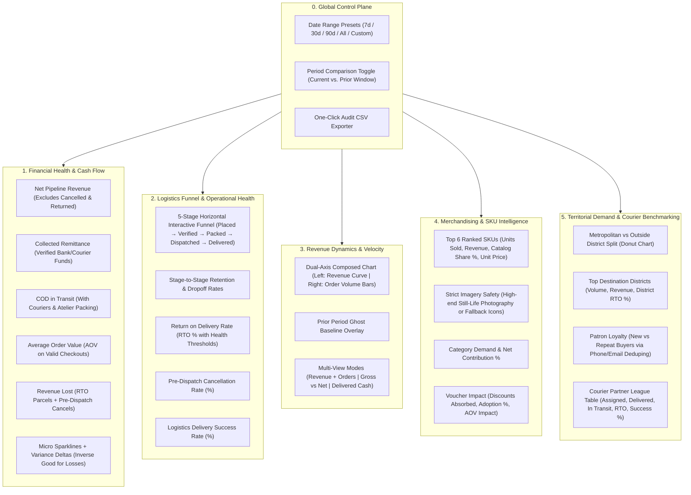

# E-Commerce Executive BI & Operations Analytics Dashboard Skill

A comprehensive, production-grade guide for AI agents to design, construct, integrate, and verify an executive-grade **Business Intelligence (BI) & Operations Analytics Dashboard** in any web application, headless store, or administrative portal.

---

## 1. Architectural Philosophy

Standard e-commerce dashboards often fail store operators because they present **vanity metrics** and **misleading financial aggregates**:
1. **Gross Revenue Deception:** Displaying total order values without deducting cancelled orders or returned parcels (RTO) drastically overstates actual income.
2. **No Comparative Context:** A revenue number without a prior-period delta ($+14.2\%$ vs prior 30 days) makes it impossible to discern growth from stagnation.
3. **Logistics Blindspot:** For Cash-on-Delivery (COD) and multi-step fulfillment models, revenue is not realized until the courier deposits collected remittance. In-transit cash and return leakage must be visible in real time.
4. **Disconnected Merchandising:** Revenue trends disconnected from individual SKU demand, category shares, and discount voucher absorption obscure which products actually drive margin.

This skill implements an **enterprise 5-pillar BI architecture**:



---

## 2. Universal Data Contract

Every metric in this architecture is computable purely from standard e-commerce order records. No specialized OLAP database is required; the calculation engine runs on raw arrays in the browser or via backend query.

```typescript
export interface UniversalOrderItem {
  id?: string;
  product: {
    id: string;
    name: string;
    category: string;
    price: number;
    featuredImage?: string;
  };
  quantity: number;
}

export interface UniversalOrder {
  orderId: string;
  createdAt: string | Date;
  status:
    | 'pending'
    | 'verified'
    | 'packaging'
    | 'handed_to_courier'
    | 'delivered'
    | 'returned'
    | 'cancelled';
  courierPartner?: string | null;
  consignmentId?: string | null;
  customer?: {
    fullName: string;
    phone: string;
    email?: string;
    address?: string;
    district?: string;
  };
  subtotal: number;
  shippingFee: number;
  discountAmount?: number;
  couponCode?: string;
  grandTotal: number;
  items: UniversalOrderItem[];
}
```

---

## 3. The 5-Phase Implementation Protocol


### Phase 0: Schema Audit & Data Adapter
1. **Locate Order Source:** Locate where the application fetches orders (e.g. `OrdersContext`, Redux store, React Query, or Prisma/SQL server actions).
2. **Verify Field Availability:**
   - Order timestamp: `createdAt` (ISO string or Date).
   - Order total: `grandTotal` or `totalAmount`.
   - Lifecycle status: Verify status strings match or map to the 7 standard lifecycle stages (`pending`, `verified`, `packaging`, `handed_to_courier`, `delivered`, `returned`, `cancelled`).
   - Customer phone/identifier: Used for repeat patron frequency deduping.
   - Region/District: Used for territorial breakdowns.
   - Item relations: Ensure product category, unit price, and image are joined or looked up via catalog fallback.

### Phase 1: Time-Window Math Engine (`useAnalyticsData.ts`)
1. Implement the mathematical core with date boundaries:
   - Calculate `start` and `end` from preset (`7d`, `30d`, `90d`, `all`, `custom`).
   - Normalize start to `00:00:00.000` and end to `23:59:59.999` to prevent timezone clipping.
   - Derive the identical duration preceding period (`prevStart` to `prevEnd`).
2. Slicing orders:
   - Split orders into `currentOrders` and `previousOrders`.
   - Calculate sparkline intervals (divide period duration into 7 equal slices).
3. Guard every calculation with zero-division fallbacks (`0`, never `NaN` or `Infinity`).

### Phase 2: Financial Health Strip (`FinancialHealthCards.tsx`)
Construct the 5 financial cards:
1. **Net Pipeline Revenue:** $\sum \text{grandTotal}$ where status is NOT `cancelled` and NOT `returned`.
2. **Collected Remittance:** $\sum \text{grandTotal}$ where status IS `delivered`.
3. **COD in Transit:** $\sum \text{grandTotal}$ where status IS `handed_to_courier` or `packaging`.
4. **Average Order Value (AOV):** $\text{Net Revenue} / \text{Valid Orders Count}$.
5. **Revenue Lost:** $\sum \text{grandTotal}$ where status IS `cancelled` or `returned`.
6. **Inverse Delta Semantics:** For Revenue Lost, assign `isInverseGood = true`. If losses decrease, display an **emerald badge** ($\downarrow 5.2\%$); if losses rise, display a **rose alert badge** ($\uparrow 12.4\%$).

### Phase 3: Logistics Funnel & Operational Health (`OrderFunnelSection.tsx`)
1. Build the 5 horizontal stages:
   - Stage 1: Placed / Logged ($100\%$)
   - Stage 2: Phone Verified (conversion from Stage 1)
   - Stage 3: Handcrafted & Packed (conversion from Stage 2)
   - Stage 4: Dispatched with Courier (conversion from Stage 3)
   - Stage 5: Delivered & Remitted (conversion from Stage 4)
2. Add the 3 operational health indicator tiles:
   - **Return Rate (RTO %):** $\frac{\text{Returned}}{\text{Delivered} + \text{Returned}} \times 100$. Include health badge: $<5\%$ Healthy, $5-10\%$ Attention, $>10\%$ High Risk.
   - **Cancellation Rate (%):** $\frac{\text{Cancelled}}{\text{Total Orders}} \times 100$.
   - **Delivery Success Rate (%):** $\frac{\text{Delivered}}{\text{Delivered} + \text{Returned}} \times 100$.

### Phase 4: Revenue Dynamics & Merchandising (`RevenueTrendChart.tsx` & `ProductIntelligenceSection.tsx`)
1. **Dual-Axis Composed Chart:**
   - Left Y-Axis: Currency scale formatted with comma separators.
   - Right Y-Axis: Order count integer scale.
   - Area curve for Net Revenue.
   - Bar series for Daily Order Volume.
   - Dotted ghost line for previous period baseline when comparison is active.
   - View mode switcher: `Revenue + Orders`, `Gross vs Net`, `Delivered Cash`.
2. **Top-Performing SKUs Table:**
   - Rank items by total revenue generated.
   - Include thumbnail with strict visual safety (only still-life photography or luxury fallback icon, strictly zero human faces/models).
   - Display units sold, revenue, share of net catalog revenue with a horizontal micro-progress bar.
3. **Category Contribution:**
   - Display horizontal bars comparing revenue share % and units sold across categories.
4. **Voucher Absorption Banner:**
   - Calculate total discounts given, percentage of orders using promos, and compare AOV of voucher orders vs. organic full-price checkouts.

### Phase 5: Territorial Demand & Courier Benchmarking (`CustomerRegionalSection.tsx`)
1. **Territorial Distribution:**
   - Metropolitan vs. Outside Districts (Donut chart with order count and revenue).
   - Top 8 destination regions table with local return rates.
2. **Patron Loyalty:**
   - Group orders by phone number across the complete historical database.
   - Customers with $\ge 2$ orders = Returning Patrons; 1 order = First-Time Patrons.
   - Calculate Repeat Purchase Rate (%) and Repeat Revenue Share (%).
3. **Courier Partner League Table:**
   - Group dispatched orders by `courierPartner`.
   - Calculate total assigned, delivered, in-transit, returned (RTO), and logistics success rate %.

---

## 4. Mathematical Formulas & Precision Rules

| Metric | Exact Mathematical Formula | Zero-Division Guard |
| :--- | :--- | :--- |
| **Net Revenue** | $\sum_{\text{valid}} \text{grandTotal} \quad (\text{status} \notin \{\text{cancelled}, \text{returned}\})$ | Returns `0` if empty |
| **AOV** | $\frac{\text{Net Revenue}}{\text{Count}(\text{valid orders})}$ | Returns `0` if valid count $= 0$ |
| **Delta %** | $\left| \frac{\text{Current} - \text{Previous}}{\text{Previous}} \right| \times 100$ | If previous $= 0$, returns `100%` if current $> 0$, else `0%` |
| **Return Rate (RTO %)** | $\frac{\text{Count}(\text{returned})}{\text{Count}(\text{delivered}) + \text{Count}(\text{returned})} \times 100$ | Returns `0` if denominator $= 0$ |
| **Cancel Rate** | $\frac{\text{Count}(\text{cancelled})}{\text{Count}(\text{all orders})} \times 100$ | Returns `0` if total orders $= 0$ |
| **Delivery Success %** | $\frac{\text{Count}(\text{delivered})}{\text{Count}(\text{delivered}) + \text{Count}(\text{returned})} \times 100$ | Returns $100 - \text{Cancel Rate}$ if none completed |
| **Repeat Patron Rate** | $\frac{\text{Count}(\text{customers with } \ge 2 \text{ orders})}{\text{Count}(\text{unique customers in period})} \times 100$ | Returns `0` if unique count $= 0$ |

---

## 5. Critical Edge Cases & Defensive Safeguards

> [!CAUTION]
> **React 19 / Modern Bundler Static Component Rule:**
> Never declare tooltip components (e.g. `CustomTooltip`, `CustomPieTooltip`) inside the body of a React component during render. In React 19, this triggers the `react-hooks/static-components` ESLint error and forces continuous remounting. Always declare tooltips as standalone functions outside the component body.

> [!IMPORTANT]
> **Strict Imagery Safety Policy:**
> For luxury, jewelry, or compliance-strict brands, visual assets in the analytics desk must strictly feature **still-life product photography** or clean abstract UI icons. Never display or generate human models, faces, or silhouettes. Always configure graceful `onError` fallback handling.

> [!TIP]
> **Date Window Midnight Normalization:**
> Always normalize start dates to `00:00:00.000` and end dates to `23:59:59.999`. If dates are parsed with default UTC timestamps, orders placed in late afternoon/evening hours in local timezones ($+06:00$ etc.) will be omitted from daily buckets.

---

## 6. Verification & Audit Checklist

Before declaring the analytics desk complete on any target project, execute this verification run:

- [ ] **Type Check:** Run `npx tsc --noEmit` — 0 errors.
- [ ] **Lint Cleanliness:** Run `npx eslint` over all analytics files — 0 errors, 0 warnings.
- [ ] **Zero Division Guard:** Run the verification script:
  ```bash
  npx tsx scripts/verify-analytics-engine.ts
  ```
  Verify that all 17 mathematical assertions pass.
- [ ] **Date Preset Verification:** Toggle through `7d`, `30d`, `90d`, `All Time`, and `Custom` — verify all cards, charts, and tables update synchronously.
- [ ] **Comparison Mode:** Toggle "Compare to prior period" — verify delta badges and ghost baseline curves appear without NaN values.
- [ ] **Export Test:** Click "Export CSV" — verify the downloaded `.csv` file contains properly formatted currency numbers and correct section headings.
- [ ] **Production Build:** Run `npm run build` or `vite build` — verify zero hydration errors or bundle compilation warnings.

---

## 7. Reference Files in This Skill

- [`references/types.ts`](file:///Users/sahil/MyDocs/Web%20Dev/adorous%20V2/.agents/skills/ecommerce-bi-analytics-dashboard/references/types.ts): Canonical TypeScript interfaces for all metrics, rates, and configurations.
- [`references/useAnalyticsData.ts`](file:///Users/sahil/MyDocs/Web%20Dev/adorous%20V2/.agents/skills/ecommerce-bi-analytics-dashboard/references/useAnalyticsData.ts): Universal client-side analytics hook with zero-crash calculations and CSV exporter.
- [`references/DateRangeSelector.tsx`](file:///Users/sahil/MyDocs/Web%20Dev/adorous%20V2/.agents/skills/ecommerce-bi-analytics-dashboard/references/DateRangeSelector.tsx): Filter bar with presets, custom calendar pickers, and comparison toggle.
- [`references/FinancialHealthCards.tsx`](file:///Users/sahil/MyDocs/Web%20Dev/adorous%20V2/.agents/skills/ecommerce-bi-analytics-dashboard/references/FinancialHealthCards.tsx): 5 headline cards with SVG sparklines and semantic delta badges.
- [`references/OrderFunnelSection.tsx`](file:///Users/sahil/MyDocs/Web%20Dev/adorous%20V2/.agents/skills/ecommerce-bi-analytics-dashboard/references/OrderFunnelSection.tsx): Horizontal order pipeline with dropoff callouts and operational rates.
- [`references/RevenueTrendChart.tsx`](file:///Users/sahil/MyDocs/Web%20Dev/adorous%20V2/.agents/skills/ecommerce-bi-analytics-dashboard/references/RevenueTrendChart.tsx): Dual-axis Recharts composed visualization with multi-view toggles.
- [`references/ProductIntelligenceSection.tsx`](file:///Users/sahil/MyDocs/Web%20Dev/adorous%20V2/.agents/skills/ecommerce-bi-analytics-dashboard/references/ProductIntelligenceSection.tsx): Ranked top SKUs, category demand bars, and promo voucher absorption.
- [`references/CustomerRegionalSection.tsx`](file:///Users/sahil/MyDocs/Web%20Dev/adorous%20V2/.agents/skills/ecommerce-bi-analytics-dashboard/references/CustomerRegionalSection.tsx): Regional distribution donut, district demand ranking, and courier league table.
- [`scripts/verify-analytics-engine.ts`](file:///Users/sahil/MyDocs/Web%20Dev/adorous%20V2/.agents/skills/ecommerce-bi-analytics-dashboard/scripts/verify-analytics-engine.ts): Automated unit test harness verifying mathematical safety.
