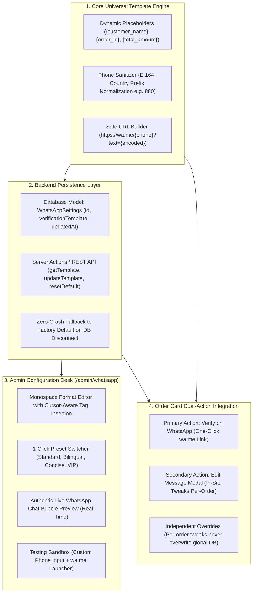
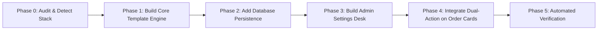

# Editable WhatsApp Message Template System Skill

A complete, production-grade guide for AI agents to design, construct, integrate, and verify an editable WhatsApp order verification and messaging system in any web application or e-commerce stack.

Follow this protocol whether the target codebase already has a basic WhatsApp button or has **no existing WhatsApp messaging system at all**.

---

## Architecture Overview



---

## The 5-Phase Implementation Protocol



---

### Phase 0: Codebase Audit & Stack Detection

Before writing code, inspect the codebase to determine the baseline state:

1. **Check for Existing WhatsApp Logic**:
   - Search for `wa.me`, `api.whatsapp.com`, `whatsapp`, or `MessageCircle` across the codebase.
   - If found: Locate where messages are constructed (often hardcoded template literals inside order cards or utility files).
   - If NOT found: You will implement both the baseline order-to-WhatsApp link generator and the editable template system from scratch.
2. **Identify Frontend Framework**:
   - Next.js (App Router vs Pages Router), React/Vite, Remix, Vue/Nuxt, or plain SSR templates.
3. **Identify Database / ORM**:
   - Prisma (`prisma/schema.prisma`), Drizzle (`drizzle/schema.ts`), Mongoose/MongoDB, Supabase/PostgreSQL, or flat-file JSON.

---

### Phase 1: Build Core Universal Template Engine

Create a standalone utility module (e.g. `src/lib/whatsappTemplate.ts` or `lib/whatsapp-template.ts`). It must remain 100% resilient and never throw errors even if given null or undefined order objects.

#### 1. Standard Placeholder Dictionary
Support both single-brace `{variable}` and double-brace `{{variable}}` with whitespace tolerance and case-insensitivity:

Variable Tag | Source Property | Fallback Value
:--- | :--- | :---
`{customer_name}` | `order.customer.fullName` or `order.customerName` | `'Valued Patron'`
`{order_id}` | `order.orderId` or `order.id` | `'Order'`
`{items}` | Comma-separated product names with color/size & quantity | `'Ordered Pieces'`
`{items_detailed}` | Bulleted multi-line breakdown with unit prices | `'• Ordered Pieces'`
`{total_amount}` | Final payable COD collection / grand total | `'0'`
`{subtotal}` | Items subtotal before shipping and discounts | `'0'`
`{shipping_fee}` | Delivery fee / shipping charge | `'0'`
`{discount}` | Voucher or promotional discount | `'0'`
`{delivery_address}` | Street address + city/district | `'Customer Address'`
`{district}` | District / City / Region | `''`
`{customer_phone}` | Raw or formatted phone number | `''`
`{date}` | Formatted order creation date (e.g. `Nov 16, 2026`) | `'Recent'`

#### 2. Default Factory Template
```typescript
export const DEFAULT_WHATSAPP_VERIFICATION_TEMPLATE = `Hello {customer_name}! Greetings from our store.

We have received your Cash on Delivery order: {order_id}

Items: {items}

Total Amount: ৳{total_amount}

Delivery Address: {delivery_address}

Please confirm if this address is correct so we can package and dispatch your order today.`;
```

#### 3. Phone Number Sanitizer & wa.me URL Builder
WhatsApp click-to-chat requires digits only without leading `+` or punctuation. For national delivery markets (e.g. Bangladesh `01...`), automatically prepend the country code (`880`):

```typescript
export function sanitizeWhatsAppPhone(phone?: string | null, countryCode = '88'): string {
  if (!phone) return '';
  let digits = String(phone).replace(/[^0-9]/g, '');
  if (countryCode === '88' && digits.startsWith('01') && digits.length === 11) {
    digits = '88' + digits;
  }
  return digits;
}

export function buildWhatsAppChatUrl(phone: string, text: string, countryCode = '88'): string {
  const cleanPhone = sanitizeWhatsAppPhone(phone, countryCode);
  return `https://wa.me/${cleanPhone}?text=${encodeURIComponent(text)}`;
}
```

#### 4. Safe Multi-Format Regex Engine
```typescript
export function renderWhatsAppVerificationMessage(template: string | null | undefined, order: any): string {
  const rawTemplate = (template && template.trim().length > 0)
    ? template
    : DEFAULT_WHATSAPP_VERIFICATION_TEMPLATE;

  if (!order) return rawTemplate;

  const replacements: Record<string, string> = {
    customer_name: order.customer?.fullName || order.customerName || 'Valued Patron',
    order_id: order.orderId || order.id || 'Order',
    items: extractItemsCompact(order),
    items_detailed: extractItemsDetailed(order),
    total_amount: formatPrice(order.grandTotal ?? order.total ?? 0),
    subtotal: formatPrice(order.subtotal ?? 0),
    shipping_fee: formatPrice(order.shippingFee ?? 0),
    discount: formatPrice(order.discountAmount ?? 0),
    delivery_address: formatFullAddress(order.customer?.address, order.customer?.district),
    district: order.customer?.district || '',
    customer_phone: order.customer?.phone || order.phone || '',
    phone: order.customer?.phone || order.phone || '',
    date: formatDate(order.createdAt),
  };

  let rendered = rawTemplate;
  for (const [key, val] of Object.entries(replacements)) {
    // Replaces {key}, {{key}}, { key }, {{ key }} case-insensitively
    const pattern = new RegExp(`\\{\\{?\\s*${key}\\s*\\}?}`, 'gi');
    rendered = rendered.replace(pattern, val);
  }
  return rendered;
}
```

---

### Phase 2: Database Persistence Layer

Store the global verification template in the project's database so modifications persist across server restarts and deployments.

#### 1. Database Schema
- **Prisma** (`prisma/schema.prisma`):
  ```prisma
  model WhatsAppSettings {
    id                   String   @id @default("default")
    verificationTemplate String   @default("Hello {customer_name}! Greetings from our store.\n\nWe have received your Cash on Delivery order: {order_id}\n\nItems: {items}\n\nTotal Amount: ৳{total_amount}\n\nDelivery Address: {delivery_address}\n\nPlease confirm if this address is correct so we can package and dispatch your order today.")
    updatedAt            DateTime @updatedAt
    createdAt            DateTime @default(now())
  }
  ```
  Run: `npx prisma db push` or `npx prisma migrate dev`.

- **Drizzle / MongoDB / SQL**:
  Refer to [backend-adapters.ts](./references/backend-adapters.ts) for Drizzle, Mongoose, or local file fallbacks.

#### 2. Server Actions / API Handlers
Implement resilient read, update, and reset operations with wrapped cache revalidation:

```typescript
'use server';

import { prisma } from '@/lib/db';
import { revalidatePath } from 'next/cache';
import { DEFAULT_WHATSAPP_VERIFICATION_TEMPLATE } from '@/lib/whatsappTemplate';

export async function getWhatsAppSettings() {
  try {
    if (!prisma.whatsAppSettings) return { id: 'default', verificationTemplate: DEFAULT_WHATSAPP_VERIFICATION_TEMPLATE };
    const settings = await prisma.whatsAppSettings.findUnique({ where: { id: 'default' } });
    return settings || { id: 'default', verificationTemplate: DEFAULT_WHATSAPP_VERIFICATION_TEMPLATE };
  } catch (err) {
    console.warn('[WhatsAppSettings] DB error, using default:', err);
    return { id: 'default', verificationTemplate: DEFAULT_WHATSAPP_VERIFICATION_TEMPLATE };
  }
}

export async function updateWhatsAppVerificationTemplate(template: string) {
  try {
    if (!template?.trim()) return { success: false, error: 'Template cannot be empty' };
    const updated = await prisma.whatsAppSettings.upsert({
      where: { id: 'default' },
      update: { verificationTemplate: template.trim() },
      create: { id: 'default', verificationTemplate: template.trim() },
    });

    try {
      revalidatePath('/admin');
      revalidatePath('/admin/whatsapp');
    } catch {
      // Safely ignore when called outside Next.js request context
    }

    return { success: true, settings: updated };
  } catch (err: any) {
    return { success: false, error: err?.message || 'Failed to update template' };
  }
}

export async function resetWhatsAppVerificationTemplate() {
  return updateWhatsAppVerificationTemplate(DEFAULT_WHATSAPP_VERIFICATION_TEMPLATE);
}
```

---

### Phase 3: Build Admin Settings Desk (`/admin/whatsapp`)

Create an intuitive, luxury-grade administration desk for store managers.

#### Essential Features of `/admin/whatsapp`:
1. **Monospace Format Editor**:
   - Displays character count and line count.
   - Textarea attached to a React `useRef` to track text cursor position.
2. **1-Click Variable Inserter**:
   - Clickable badges for `{customer_name}`, `{order_id}`, `{items}`, `{total_amount}`, etc.
   - Clicking a badge immediately inserts the tag at the current cursor position inside the textarea without losing focus.
3. **Pre-Configured Message Presets**:
   - Provide 4 industry-tested presets:
     - **Standard Verification**: Professional, comprehensive English format.
     - **Bilingual (Local Language + English)**: High trust and conversion.
     - **Concise & Direct**: Fast verification for busy patrons.
     - **VIP Atelier**: Highlighting packaging, craftsmanship, and bespoke care.
4. **Authentic Live WhatsApp Preview**:
   - Real-time chat bubble styled with authentic WhatsApp colors:
     - Header: `#1F2C34` with store monogram and "online" status.
     - Wallpaper: `#0B141A` with subtle dot matrix or dark slate background.
     - Outgoing Bubble: `#005C4B` (Dark Emerald) with white text, timestamp (`11:22 AM`), and double checkmarks (`✓✓`).
5. **Interactive Sandbox Testing**:
   - Phone input with instant "Test on WhatsApp" (`wa.me`) link and "Copy Message" button.

> **Full Code Reference**: See [admin-whatsapp-page.tsx](./references/admin-whatsapp-page.tsx) for the complete drop-in React component.

---

### Phase 4: Integrate Dual-Action on Order Cards

On the order management desk (e.g. `/admin` or order table cards), implement the **Dual-Action Pattern**:

```tsx
<div className="flex items-center space-x-1">
  {/* 1. Primary One-Click Action */}
  <a
    href={generateWhatsAppVerificationLink(order)}
    target="_blank"
    rel="noopener noreferrer"
    className="flex-1 py-2 bg-emerald-700 hover:bg-emerald-600 text-white rounded-xs font-semibold text-[11px] uppercase tracking-wider flex items-center justify-center space-x-1.5 transition-colors shadow-xs"
  >
    <MessageCircle className="w-3.5 h-3.5" />
    <span>Verify on WhatsApp</span>
  </a>

  {/* 2. Secondary In-Situ Customization Action */}
  <button
    type="button"
    onClick={() => handleOpenCustomMessageModal(order)}
    className="py-2 px-2.5 bg-emerald-800/80 hover:bg-emerald-700 border border-emerald-600/40 text-emerald-200 hover:text-white rounded-xs text-[11px] flex items-center justify-center transition-colors shadow-xs cursor-pointer"
    title="Edit message for this order before opening WhatsApp"
  >
    <Edit3 className="w-3.5 h-3.5" />
  </button>
</div>
```

#### The In-Situ Customizer Modal
When the pencil icon is clicked:
1. Render a clean modal containing that order's details (`orderId`, patron name, phone number).
2. Pre-fill a textarea with `renderWhatsAppVerificationMessage(activeTemplate, order)`.
3. Allow the admin to type custom notes (e.g. "Special requested morning delivery", "Gift wrap included").
4. Provide a green **"Open in WhatsApp"** button (`buildWhatsAppChatUrl(phone, customText)`) and a **"Copy Message"** button.
5. **Critical Guard**: The modal operates on temporary local component state for that specific order. It MUST NEVER overwrite the global backend template stored in the database!

> **Full Code Reference**: See [per-order-modal.tsx](./references/per-order-modal.tsx) for the complete component implementation.

---

### Phase 5: Automated Verification & Non-Breaking Checklist

Before considering the task complete, execute the test script and verify every item on this checklist:

```bash
npx tsx .agents/skills/editable-whatsapp-message-template/scripts/verify-whatsapp-system.ts
```

#### The 10-Point Verification Checklist:
- [ ] **Variable Replacement**: All placeholders (`{customer_name}`, `{order_id}`, etc.) replace accurately.
- [ ] **Syntax Flexibility**: Supports both `{tag}` and `{{tag}}` with optional spaces.
- [ ] **Zero Crash Guarantee**: Passing an empty or malformed order renders clean fallbacks with zero `'undefined'` or `'null'` substrings.
- [ ] **Phone Number Sanitization**: Automatically strips non-digits and normalizes national phone numbers with correct international prefixes.
- [ ] **URI Encoding**: UTF-8 characters (Bangla, Arabic, accented characters) and emojis encode cleanly without broken symbols.
- [ ] **DB Persistence**: Saving a new template updates the database table and reloads correctly across sessions.
- [ ] **Reset Factory Default**: Reset action safely restores the default factory verification template.
- [ ] **Cursor-Aware Insertion**: Clicking a variable pill in the admin GUI inserts at the exact caret position.
- [ ] **Isolation Guarantee**: Modifying a message in the per-order modal alters only that specific message and leaves the global database template untouched.
- [ ] **Visual Hierarchy**: Matches the project's dark/light luxury styling with responsive mobile support.
