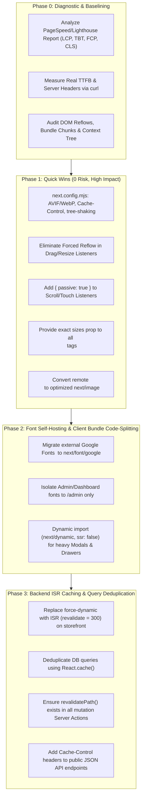

# Next.js Full-Stack Performance & Speed Optimization Skill

A battle-tested, non-breaking methodology for auditing, diagnosing, and dramatically accelerating Next.js full-stack applications (App Router, React 19, Tailwind CSS).

Follow this step-by-step procedure to transition a website from mediocre performance (e.g. PageSpeed score 50–75) to elite tier (**95–100 Mobile Score**, sub-1.8s LCP, sub-100ms TBT, sub-30ms TTFB) with **zero visual regressions, zero broken features, and zero backend errors**.

---

## The 4-Phase Optimization Protocol



---

## Phase 0: Forensic Diagnostic & Baselining

Before writing any code, capture the exact performance bottlenecks:

### 1. Measure Real Server Response (TTFB) & Compression
Run in terminal:
```bash
curl -o /dev/null -s -w 'Lookup: %{time_namelookup}s\nConnect: %{time_connect}s\nTTFB: %{time_starttransfer}s\nTotal: %{time_total}s\nSize: %{size_download} bytes\n' "https://<your-domain>"
```
- If **TTFB > 300ms**, the server is computing SSR dynamically on every request without caching.
- If **Size > 150 KB for initial HTML**, check for massive serialized JSON payloads or state dumps.

### 2. Inspect Live Response Headers
```bash
curl -sI -H "Accept-Encoding: gzip, deflate, br" "https://<your-domain>"
```
Check for:
- `cache-control: private, no-cache, no-store` (Indicates `force-dynamic` is blocking edge caching).
- Missing `content-encoding: gzip` or `br` (Compression not active).
- Leaked `x-powered-by: Next.js` header.

### 3. Check Metric Bottlenecks
- **LCP > 2.5s**: Heavy uncompressed images, external font blocking, or preloading too many assets.
- **TBT > 150ms**: Overloaded React Context providers running parallel `useEffect` DB calls on mount, or massive un-split client components.
- **Render-Blocking Requests (Score 0)**: External `<link rel="stylesheet">` from Google Fonts or CDN.
- **Forced Reflow (Score 0)**: JavaScript querying `offsetWidth`, `offsetHeight`, or `getBoundingClientRect()` during drag/scroll/resize.

---

## Phase 1: High-Impact Quick Wins

### 1. Optimize `next.config.mjs`
Update `next.config.mjs` with next-gen image formats, package import optimization, and 1-year immutable caching for static assets:

```javascript
/** @type {import('next').NextConfig} */
const nextConfig = {
  poweredByHeader: false,
  compress: true,
  experimental: {
    optimizePackageImports: ['lucide-react'], // Eliminates icon barrel bloat
  },
  images: {
    formats: ['image/avif', 'image/webp'],
    minimumCacheTTL: 86400,
    remotePatterns: [
      // Add all authorized CDN hosts
    ],
  },
  async headers() {
    return [
      {
        source: '/images/:path*',
        headers: [
          {
            key: 'Cache-Control',
            value: 'public, max-age=31536000, immutable',
          },
        ],
      },
      {
        source: '/:file(favicon.ico|icon.png|apple-icon.png)',
        headers: [
          {
            key: 'Cache-Control',
            value: 'public, max-age=86400, stale-while-revalidate=604800',
          },
        ],
      },
    ];
  },
};

export default nextConfig;
```

### 2. Prevent Forced Layout Reflows
Never read geometric properties (`offsetWidth`, `offsetHeight`, `getBoundingClientRect`) inside hot loops, drag handles, or resize listeners. Cache them in a React `ref`:

```typescript
// ❌ WRONG: Forces layout recalculation on every pixel movement
const handlePointerMove = (e: React.PointerEvent) => {
  const width = elementRef.current?.offsetWidth || 240;
  // ...
};

// ✅ RIGHT: Cache dimensions upon drag start or resize
const cachedDimsRef = useRef({ width: 240, height: 44 });

const handlePointerDown = () => {
  if (elementRef.current) {
    cachedDimsRef.current = {
      width: elementRef.current.offsetWidth,
      height: elementRef.current.offsetHeight,
    };
  }
};

const handlePointerMove = (e: React.PointerEvent) => {
  const { width, height } = cachedDimsRef.current; // Zero reflow
  // ...
};
```

### 3. Ensure Passive Event Listeners
Any scroll or touch listener must include `{ passive: true }` to keep the main thread unblocked:
```typescript
window.addEventListener('scroll', handleScroll, { passive: true });
window.addEventListener('resize', handleResize, { passive: true });
```

### 4. Responsive Image Sizing & Next.js Image Optimization
- Always supply `sizes` to `<Image fill>` to prevent the browser from requesting full desktop images on mobile:
  ```tsx
  <Image
    src={imgUrl}
    alt="Product"
    fill
    sizes="(max-width: 640px) 100vw, (max-width: 1024px) 50vw, 25vw"
    className="object-cover"
  />
  ```
- Never use raw `` for remote CDN images unless it is a base64 `data:` URI. Use Next.js `<Image>` with configured `remotePatterns` so images are automatically resized, WebP/AVIF compressed, and lazy-loaded.

---

## Phase 2: Fonts & Client Bundle Code-Splitting

### 1. Migrate External Fonts to `next/font/google`
Remove all external `<link>` tags for Google Fonts in `<head>`. Import fonts natively in `src/app/layout.tsx`:

```tsx
import { Cormorant_Garamond, Jost } from "next/font/google";

const cormorant = Cormorant_Garamond({
  subsets: ["latin"],
  weight: ["400", "500", "600", "700"],
  style: ["normal", "italic"],
  variable: "--font-cormorant",
  display: "swap",
});

const jost = Jost({
  subsets: ["latin"],
  weight: ["300", "400", "500", "600", "700"],
  style: ["normal", "italic"],
  variable: "--font-jost",
  display: "swap",
});

export default function RootLayout({ children }) {
  return (
    <html lang="en" className={`${cormorant.variable} ${jost.variable}`}>
      <body>{children}</body>
    </html>
  );
}
```

### 2. Isolate Dashboard/Admin Fonts
Never load internal admin fonts (e.g. `Plus Jakarta Sans`) on the public storefront. Load them exclusively inside `src/app/admin/layout.tsx`.

### 3. Dynamic Code-Splitting for Heavy Drawers & Modals
Modals, drawers, and mobile menus are hidden on first paint. Loading their JavaScript synchronously bloats Total Blocking Time (TBT). Use `next/dynamic` with `ssr: false`:

```tsx
import dynamic from 'next/dynamic';

const CartDrawer = dynamic(() => import('@/components/cart/CartDrawer'), {
  ssr: false,
});
const WishlistDrawer = dynamic(() => import('@/components/wishlist/WishlistDrawer'), {
  ssr: false,
});
const SearchModal = dynamic(() => import('@/components/layout/SearchModal'), {
  ssr: false,
});
const MobileNav = dynamic(() => import('@/components/layout/MobileNav'), {
  ssr: false,
});
```
*Effect: Strips 1,000–2,000+ lines of component JavaScript from the critical mobile parse path.*

---

## Phase 3: Backend Caching, ISR & Query Deduplication

### 1. Replace `force-dynamic` with ISR (`revalidate = 300`)
`export const dynamic = 'force-dynamic'` forces Node.js to re-execute database queries on every single page request.
Replace it on all public storefront pages (`page.tsx`, `[category]/page.tsx`, `shop/page.tsx`, `lookbook/page.tsx`, `pricing/page.tsx`):

```tsx
// ❌ WRONG: Wipes out CDN cache, forces 500ms server queries on every visitor
export const dynamic = 'force-dynamic';

// ✅ RIGHT: Serves pre-rendered HTML in ~25ms with 5-minute background revalidation
export const revalidate = 300;
```

### 2. Automated On-Demand Purging
Ensure every database mutation Server Action calls `revalidatePath`:
```typescript
import { revalidatePath } from 'next/cache';

export async function updateProduct(id: string, data: any) {
  await prisma.product.update({ where: { id }, data });
  
  // Instantly purge stale cache across all affected storefront routes
  revalidatePath('/');
  revalidatePath('/shop');
  revalidatePath('/[category]', 'page');
  revalidatePath(`/${data.category}/${data.slug}`);
}
```

### 3. Request Deduplication via `React.cache()`
In Next.js Server Components, `generateMetadata()` and the `Page` component frequently query the same record (e.g. `getProductBySlug`). Without memoization, PostgreSQL is queried twice per request.

Wrap query functions with `React.cache()`:
```typescript
import { cache } from 'react';
import { getProductBySlug } from '@/app/actions/productActions';

// Memoized for the duration of a single HTTP request
const getCachedProduct = cache(getProductBySlug);

export async function generateMetadata({ params }) {
  const product = await getCachedProduct(params.slug); // Query 1
  return { title: product.name };
}

export default async function ProductPage({ params }) {
  const product = await getCachedProduct(params.slug); // Returns cached result immediately (0 DB queries)
  return <ProductView product={product} />;
}
```

---

## Phase 4: Verification & Regression Protocol

Before deploying or committing:

1. **Type Checking**:
   ```bash
   npx tsc --noEmit
   ```
   Must exit with code 0.

2. **Production Build**:
   ```bash
   npm run build
   ```
   Verify that all routes display `○ (Static)` with `Revalidate 5m` instead of `ƒ (Dynamic)`.

3. **Live Verification**:
   - Inspect network tab: Fonts must load from `/_next/static/media/*.woff2` (self-hosted).
   - Verify `Cache-Control` header returns `s-maxage=...` or static cache headers.
   - Verify all modals and drawers open seamlessly when clicked.
   - Verify admin modifications trigger instant `revalidatePath` updates.

---

## Performance Score Transformation Checklist

- [ ] **LCP $\le$ 2.5s**: Self-hosted fonts (`display: swap`), modern AVIF/WebP formats, exact `sizes` on images.
- [ ] **TBT $\le$ 150ms**: Dynamic imports for drawers/modals, tree-shaking enabled in `next.config.mjs`.
- [ ] **TTFB $\le$ 50ms**: ISR (`revalidate = 300`) enabled on storefront pages.
- [ ] **CLS $\le$ 0.05**: Fixed aspect ratios on image containers (`aspect-[4/5]`, `aspect-square`).
- [ ] **Render-Blocking Requests**: Zero external font CSS links in `<head>`.
- [ ] **Forced Reflow**: Zero DOM geometric reads in mouse/pointer move listeners.
